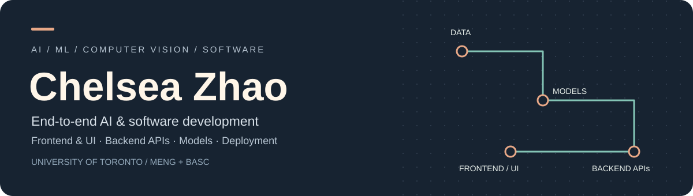

[LinkedIn](https://www.linkedin.com/in/zhao-chelsea/) | [Résumé](resume/Chelsea_Zhao_Resume.pdf)

My route into AI started in chemical engineering: production processes, quality problems, and the people who have to make a system work every day. That experience now shapes how I build software and evaluate models.

I work across the application and the analysis: preparing data with SQL and Python, building desktop interfaces, connecting APIs, running models on remote Linux machines, and turning the results into something a person can inspect and use.

**I'm looking for opportunities in data science, machine learning and AI engineering.**

## Industry experience & applied AI

| Experience | Question | Result | Methods |
| --- | --- | --- | --- |
| **[Wolseley Express · AI checkout](https://github.com/rulangyuezhao-cmd/meng-data-science-portfolio/tree/main/courses/che1800)** U of T CMTE industry project · Jan–Oct 2026 | How can images identify every part and quantity at checkout? | **107 SKUs · 94.5% accuracy** Complete-checkout measure on **2,905 validation images**. | **Vision:** PyTorch, YOLO, SAM, DINOv2 **Software:** Python, Tkinter, PyQt6, REST APIs **Data/cloud:** SQL, Azure, Docker, remote Linux |
| **Big Data & AI Competition** U of T IMI / Scotiabank · Nov 2023–Mar 2024 | Which financial records warrant investigation? | **Top 5 / 70 teams** Analyzed **560K records**. | **Classification:** XGBoost, LightGBM **Anomaly detection:** unsupervised methods, graph analysis **Data:** SQL, Python, NLP |
| **Atlantic Packaging · Analytics** Process Engineer Co-op · Aug 2021–Sep 2022 | Which process changes reduce packaging costs? | **$300K annual savings · 36% cost reduction** in the targeted process. | **Analytics:** SQL, Python **BI:** DOMO, Excel KPI dashboards **Process:** controlled parameter testing |

*Wolseley and competition code/data are confidential. The competition was industry-sponsored. Additional experience: process engineering at Crystal Claire and GMP operations at Eurofins CDMO Alphora.*

## Featured MEng & public projects

| Project | Question | Result | Methods |
| --- | --- | --- | --- |
| **[ReasonEval](https://github.com/rulangyuezhao-cmd/mie1512-reasoneval-portfolio)** MIE1512H · Winter 2026 · Jan–Apr | Can an LLM evaluator identify reasoning errors against human labels? | **3,400 solutions · 12 LLMs** Public analysis uses saved inference scores. | **AI:** ReasonEval-7B, PyTorch, Hugging Face **Evaluation:** human-label comparisons, pandas |
| **[MEng Data Science Portfolio](https://github.com/rulangyuezhao-cmd/meng-data-science-portfolio)** Coursework · 2024–2026 | How do statistical and ML methods compare across real datasets? | **15 runnable CPU analyses** Public adaptations with documented baselines and limitations. | **Statistics:** Welch tests, ANOVA, bootstrap intervals **ML:** classification, regression, clustering, PCA **Data:** SQL, pandas, NumPy |
| **[Teacher-AID](https://github.com/DarkinCoder/teacheraid)** GenAI Genesis · Mar 2026 | How can learning history guide personalized assessments? | **End-to-end prototype contribution** UI, backend, deployment and evaluation dashboards. | **AI:** DeepSeek, retrieval-grounded generation **Software:** FastAPI, API integration **Evaluation:** synthetic classroom data |

## Technical toolkit

| Area | Tools & skills |
| --- | --- |
| **AI development tools** | Codex · Claude Code |
| **Data processing & analytics** | SQL · Python · pandas · NumPy · Databricks/PySpark · data cleaning, preprocessing and EDA |
| **Business intelligence** | DOMO · Excel · KPI dashboards · analytical reporting |
| **Machine learning** | scikit-learn · XGBoost · LightGBM · classification · regression · clustering · model evaluation |
| **Deep learning** | PyTorch · TensorFlow/Keras coursework · dense neural networks · LSTM |
| **Reinforcement learning** | Fundamentals |
| **Computer vision** | OpenCV · YOLO · SAM · DINOv2 · object detection · annotation and segmentation workflows |
| **LLMs & applied AI** | Hugging Face · DeepSeek · ReasonEval · retrieval-augmented generation · GPU/CPU offloading |
| **Statistical analysis & visualization** | SciPy · statsmodels · Matplotlib · Bokeh · hypothesis testing · bootstrap confidence intervals · SHAP · LIME |
| **Programming & software engineering** | Python · OOP · HTML · CSS · JavaScript · FastAPI · HTTP/REST APIs |
| **Desktop development** | Tkinter/ttk · PyQt6/Qt · event-driven interfaces · worker threads · annotation tools |
| **Cloud & development environments** | Azure Blob/Table Storage · GCP · Docker · Linux · remote Linux/GPU workflows · SSH · SCP · VS Code |
| **Version control & collaboration** | Git · GitHub · Azure DevOps |

## Methods I've used and studied

The list below spans my projects, original coursework and documented portfolio adaptations. The linked course pages identify what is currently runnable; original neural-network, Prophet, SHAP/LIME and other experiments are not all reproduced in the compact public programs.

**Supervised learning and regression**  
Ordinary least squares / linear regression · Ridge (L2) and Lasso (L1) regression · logistic regression · support vector regression (SVR) · k-nearest neighbours · decision trees · random forest classification and regression · gradient-boosted trees with XGBoost and LightGBM · class weighting and imbalanced classification

**Unsupervised learning and anomaly detection**  
K-means · agglomerative hierarchical clustering (Ward linkage) · Gaussian mixture models · principal component analysis (PCA) and reconstruction · graph/network analysis

**Statistical inference and analysis**  
Hypothesis testing · independent-samples t-tests, including Welch's t-test · one-way ANOVA and Welch's ANOVA · Levene's variance test · bootstrap resampling and confidence intervals · Pearson correlation · IQR outlier screening · descriptive statistics · exploratory data analysis

**Time series and forecasting**  
ARIMA · SARIMA/SARIMAX and exogenous-variable modelling · Holt–Winters / exponential smoothing · vector autoregression (VAR) · Prophet · seasonal/trend regression · lag features · moving-average signals · persistence and seasonal-naive baselines

**Deep learning, computer vision and language models**  
Dense neural networks · LSTM networks · YOLO object detection · SAM-assisted segmentation · DINOv2 visual features · pretrained LLM inference · GPU/CPU offloading · retrieval-grounded generation · NLP-assisted validation · reinforcement learning fundamentals

**Optimization, interpretation and evaluation**  
Batch gradient descent · grid search · stratified cross-validation · time-series cross-validation · held-out evaluation · confusion matrices · accuracy and balanced accuracy · precision/recall and F1 · ROC AUC · MAE/RMSE · silhouette score · permutation importance · partial dependence · SHAP · LIME · Jensen–Shannon distribution comparison

[Browse the course timeline and evidence →](https://github.com/rulangyuezhao-cmd/meng-data-science-portfolio/blob/main/COURSE_COVERAGE.md)

## Education

**University of Toronto**  
M.Eng., Chemical Engineering — Data Analytics & Machine Learning emphasis; conferred October 2026.  
B.A.Sc., Chemical Engineering — Bioengineering and Engineering Business minors; conferred June 2023.

*Course dates refer to the original academic sessions. Portfolio reconstruction and documentation updates are labelled separately.*
